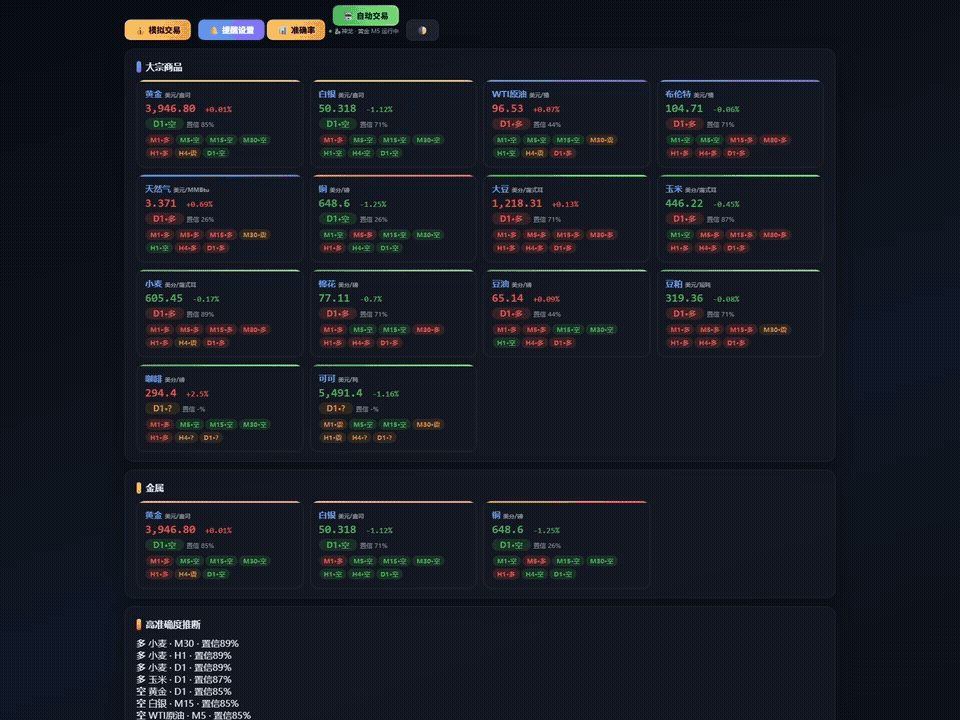
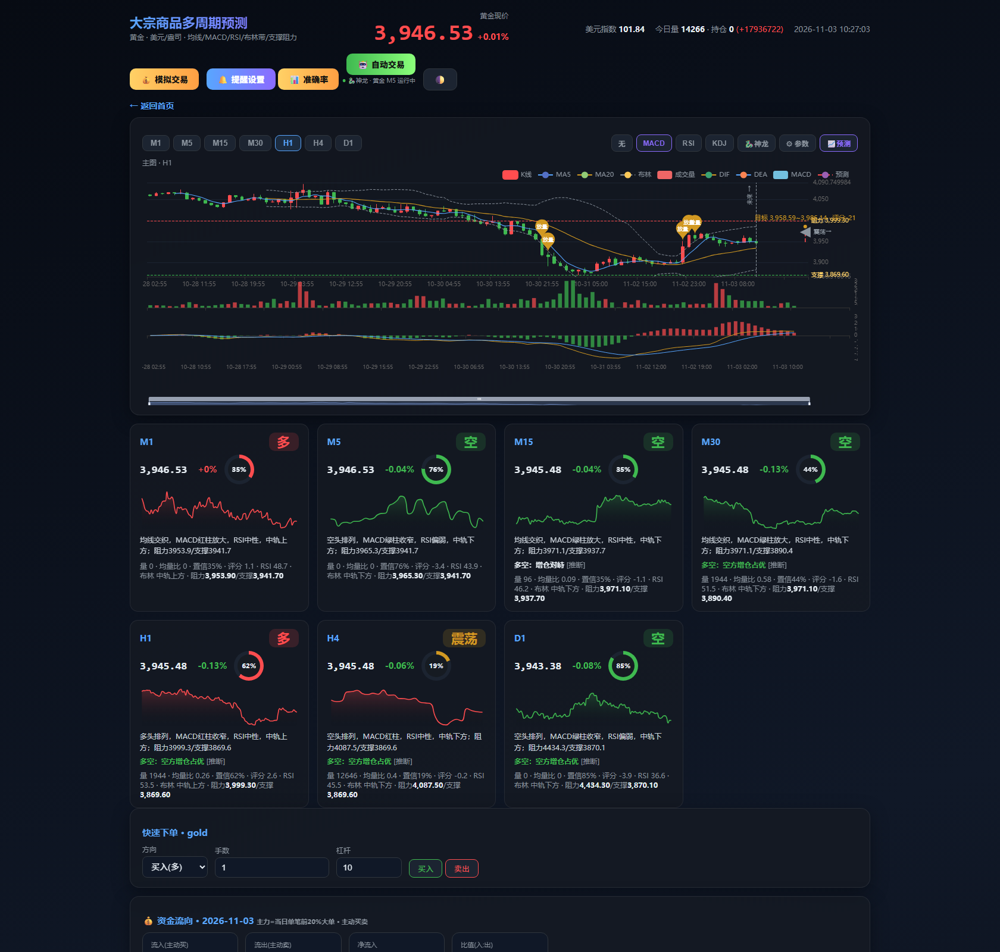
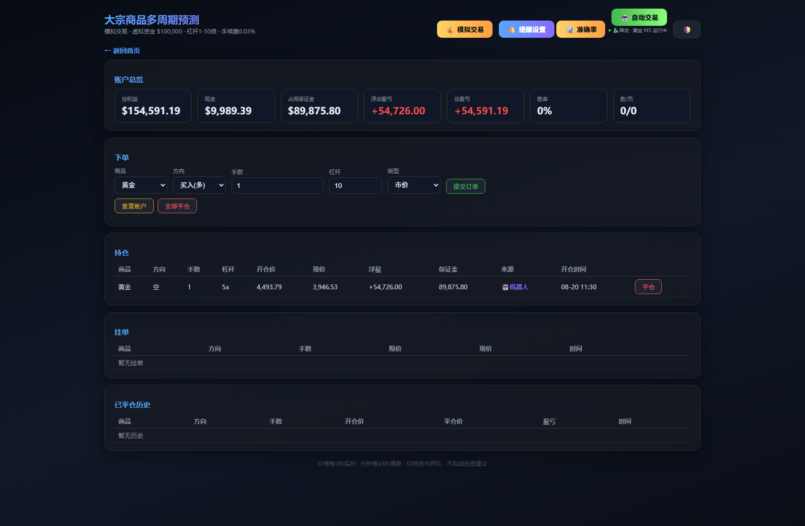
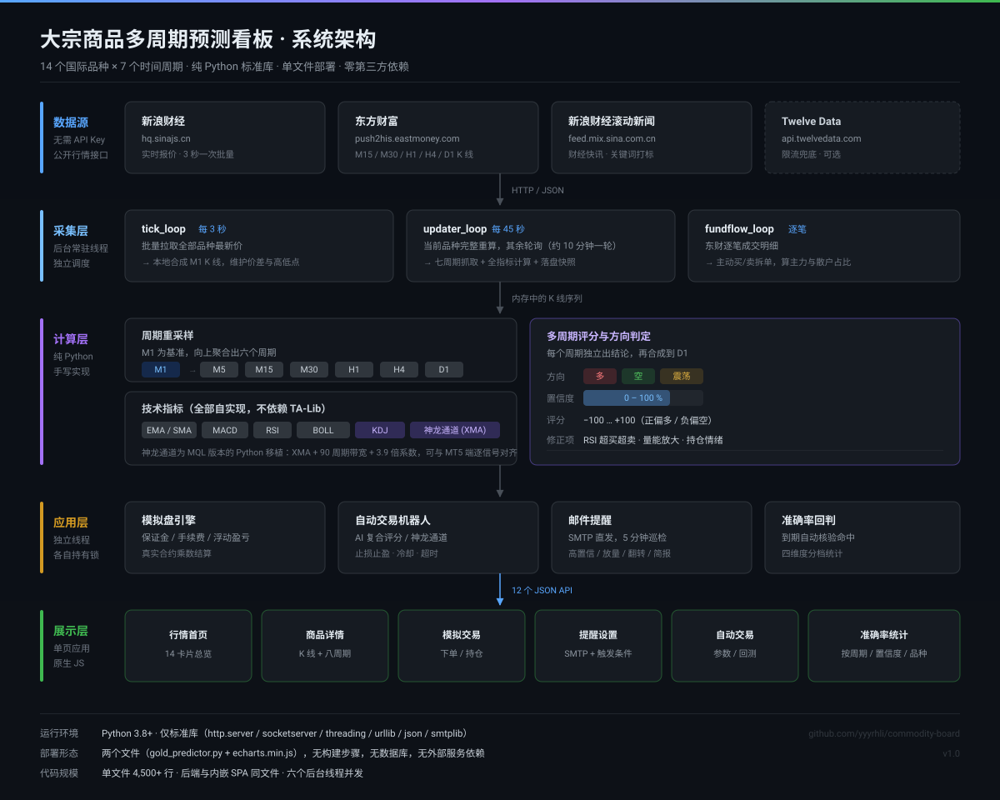

# 大宗商品多周期预测看板

**零依赖 · 单文件 · 14 个品种 × 7 个周期 · 实时行情 + 模拟盘 + 回测**

一个用纯 Python 标准库写的大宗商品行情看板：实时抓取 14 个国际品种的报价，按 M1 / M5 / M15 / M30 / H1 / H4 / D1 七个周期给出方向判断与置信度，并附带模拟下单、自动交易机器人、邮件提醒、历史回测和准确率统计。

不需要 API Key，不需要数据库，不需要 pip 装任何包。`python gold_predictor.py` 一条命令起来。



*四个核心界面轮播：行情总览 → 商品详情 → 模拟交易 → 系统架构*

---

## 目录

- [功能](#功能)
- [界面预览](#界面预览)
- [覆盖品种](#覆盖品种)
- [快速开始](#快速开始)
- [数据来源](#数据来源)
- [项目结构](#项目结构)
- [系统架构](#系统架构)
- [技术实现](#技术实现)
- [当前边界与设计取舍](#当前边界与设计取舍)
- [Roadmap](#roadmap)
- [免责声明](#免责声明)

## 功能

| 模块 | 说明 |
|---|---|
| **行情首页** | 14 个品种一屏总览：现价、涨跌幅、D1 方向 + 置信度、七周期方向标签，3 秒自动刷新 |
| **商品详情** | K 线主图（ECharts）+ 均线 / 布林带 / 成交量 / MACD / RSI / KDJ / 神龙通道；8 张周期分析卡片；阻力支撑位；放量标记 |
| **模拟交易** | 初始 $100,000，1–50 倍杠杆，市价单 / 限价单，持仓与挂单管理，保证金与浮动盈亏实时结算 |
| **自动交易** | 两套策略：AI 复合评分（D1/H1/M30 加权 + RSI / 量能 / 情绪修正）、神龙通道趋势跟随；支持止损止盈、冷却期、超时平仓、最大持仓 |
| **历史回测** | 指定策略 / 品种 / 阈值 / 止损止盈跑历史回放，输出胜率、盈亏比、最大回撤与权益曲线 |
| **邮件提醒** | 高置信度信号、放量 + 重要新闻、方向翻转、突破关键位、每日简报，SMTP 直发 |
| **准确率统计** | 每次预测自动登记，到期后回判命中；按周期 / 置信度分档 / 方向 / 品种四维度统计 |
| **Word 日报** | 一键生成当日行情 + 机器人 + 准确率汇总的 `.docx` |

## 界面预览

**商品详情页** —— 七周期联动、神龙通道买卖标记、八张分析卡片、快速下单与资金流向：



**模拟交易页** —— 账户权益、持仓、挂单、成交历史：



## 覆盖品种

| 类别 | 品种 |
|---|---|
| 贵金属 | 黄金、白银 |
| 能源 | WTI 原油、布伦特、天然气 |
| 金属 | 铜 |
| 农产品 | 大豆、玉米、小麦、棉花、豆油、豆粕、咖啡、可可 |

## 快速开始

```bash
# 1. 确认 Python 3.8+
python3 --version

# 2. 启动（默认端口 8099）
python3 gold_predictor.py --port 8099

# 3. 浏览器打开
#    http://127.0.0.1:8099
```

Windows 直接双击 `启动.bat`；Linux / macOS 可用 `bash deploy.sh` 一键部署并做健康检查。

可选参数：

```bash
python3 gold_predictor.py --port 8099 --interval 45
#   --port      监听端口，默认 8099
#   --interval  完整分析刷新间隔（秒），默认 45
```

## 数据来源

| 用途 | 来源 | 是否需要 Key |
|---|---|---|
| 实时报价 | 新浪财经 `hq.sinajs.cn`（`hf_XX` 系列） | 否 |
| K 线 | 东方财富 `push2his.eastmoney.com` | 否 |
| 美元指数 | 新浪 `DINIW` | 否 |
| 财经新闻 | 新浪财经滚动新闻 | 否 |
| 限流兜底 | Twelve Data | 可选，免费额度即可 |

M1 由 3 秒一次的实时报价本地合成，再向上重采样出 M5 / M15 / M30 / H1 / H4 / D1。

## 项目结构

```
gold_predictor.py                 核心：HTTP 服务 + 数据抓取 + 指标计算 + 交易引擎 + 内嵌前端
echarts.min.js                    图表库（本地内联，不依赖 CDN）
page_new.html                     上一版独立前端页面，留作参考
生成日报.py                        生成 Word 日报
神龙回测优化.py                    神龙信号引擎 + 5 年 M1 历史网格搜索参数
deploy.sh                         Linux 一键部署 + 健康检查
启动.bat / 启动-MobaXterm.sh       Windows 启动脚本
停止-MobaXterm.bat                Windows 停止脚本
启动出日报.sh                      启动服务并自动出当日日报
大宗商品预测系统使用手册.md         面向使用者的完整功能手册
部署运行指南.md                    部署细节与排错
docs/                             演示动图、系统架构图、界面截图
```

首次运行会在同目录自动生成状态文件（**已在 `.gitignore` 中排除**）：

```
commodity_state/*.json   每个品种的七周期分析快照
accuracy_state.json      预测准确率累计记录
trade_state.json         模拟盘账户、持仓、挂单、成交历史
fundflow_state.json      逐笔资金流向统计
bot_config.json / bot_log.json / bot_equity.json   机器人配置、动作日志、权益曲线
alert_config.json        邮件提醒配置（含 SMTP 账号，切勿提交）
api_config.json          Twelve Data Key（切勿提交）
```

要启用提醒功能，把 `alert_config.example.json` / `api_config.example.json` 复制成正式文件名再填写。

## 系统架构



整条链路只有五层，每层职责单一：

- **数据源** —— 新浪报价、东财 K 线、新浪新闻，全部公开接口，不需要注册任何 Key；Twelve Data 只在东财限流时兜底。
- **采集层** —— 三个常驻线程各自跑自己的节奏：`tick_loop` 每 3 秒批量拉报价并本地合成 M1，`updater_loop` 每 45 秒对当前品种做完整重算、其余品种轮询，`fundflow_loop` 拆逐笔成交算主力散户占比。
- **计算层** —— 以 M1 为基准向上聚合出六个周期，每个周期独立算 EMA / MACD / RSI / BOLL / 神龙通道，再折算成「方向 + 置信度 + 评分」三件套。
- **应用层** —— 模拟盘引擎、机器人、邮件提醒、准确率回判，四个模块各持一把锁，互不阻塞。
- **展示层** —— 一个原生 JS 单页应用，六个视图通过 hash 路由切换，只跟 12 个 JSON 接口打交道。

关键取舍是：**计算层不落库**。所有中间状态都活在内存里，只在必要时把快照写成 JSON，所以启动时不需要预热、也不需要任何数据库。

## 技术实现

**零第三方依赖** —— 只用 `http.server`、`socketserver`、`threading`、`urllib`、`json` 这些标准库。没有 Flask，没有 pandas，没有 numpy。`pip install` 一步都不需要，丢到任何装了 Python 3 的机器上就能跑。

**单文件架构** —— 后端逻辑与整个 SPA（HTML + CSS + JS）全部在 `gold_predictor.py` 里，部署时只需两个文件：`gold_predictor.py` + `echarts.min.js`。共 4,500 余行。

**多线程后台任务** —— 六个独立循环各司其职：`tick_loop`（3 秒行情）、`updater_loop`（45 秒分析轮询）、`bot_loop`（机器人）、`alert_loop`（提醒）、`fundflow_loop`（资金流）、`accuracy_loop`（准确率回判）。

**指标全部自实现** —— EMA / SMA / MACD / RSI / BOLL 手写，不引 TA-Lib。神龙通道是 MQL 版本的 Python 移植（XMA + 90 周期带宽 + 3.9 倍系数），可与 MT5 端逐信号对照。

**真实合约规格** —— 盈亏按实际期货合约乘数结算：黄金 100 盎司/手、白银 5,000 盎司、WTI 1,000 桶、天然气 10,000 MMBtu、铜 25,000 磅，不是拿价格差简单乘手数。

**前端零构建** —— 没有 webpack / vite / npm，一个 `<script>` 引 ECharts，其余原生 JS，改完刷新即可。

## 当前边界与设计取舍

这是一个持续迭代的研究型项目。下面几处是当前版本有意保留的简化，使用前值得了解——写在这里是为了让使用者少踩坑，不是待办清单的托词。

**1. 信号模型仍在标定阶段**

内置的准确率模块已累积 1.4 万条样本，按周期、置信度分档、方向、品种四个维度自动回判命中。目前各置信度档的命中率集中在 50% 附近，说明现在这套固定权重的多周期加权评分**还没有跑出统计优势**。

这正是下一阶段的主攻方向：把固定的经验权重换成按周期历史命中率反向标定的动态置信度。在模型收敛之前，页面上的方向标签适合当作技术面参考，不宜直接作为交易信号。模块本身是完整可用的——它诚实地把"暂时没效"也统计了出来。

**2. 模拟盘只做资金校验，未实现强平**

`place_order` 会校验可用资金是否覆盖保证金与手续费，但权益跌破保证金时不会自动平仓。因此它适合做**信号验证**，不适合做长时间的资金曲线模拟。补强平、隔夜费与滑点已列入 Roadmap。

**3. 默认按本机 / 内网场景设计**

服务绑定 `0.0.0.0`，没有鉴权层。放在本机、或通过 SSH 隧道访问都没问题；如果要暴露到公网，前面需要自己加一层反向代理和认证。这是为了保持"零依赖、双击即用"做的取舍。

**4. 行情为连续合约，不做换月复权**

取的是新浪连续合约报价，跨月换约时价格存在跳空。对 M1–M30 影响很小，D1 及以上的长周期判断会受一点影响。

**5. 咖啡、可可以及少数品种部分周期数据不全**

页面会自动标注缺失周期，不影响其他品种的正常使用。

## Roadmap

- [ ] 置信度按各周期历史命中率重新标定，替换固定权重
- [ ] 模拟盘补强平、隔夜费、滑点模型
- [ ] WebSocket 推送替代轮询，降低请求量与被限流概率
- [ ] Docker 一键部署镜像
- [ ] 多账户并行模拟，支持策略间对比
- [ ] 神龙通道信号与 MT5 EA 逐笔对齐校验工具

## 免责声明

本项目仅用于技术学习与策略研究。商品期货交易具有高风险，任何基于本项目信号做出的真实交易决策及后果由使用者自行承担。作者不对任何形式的损失负责。

## License

MIT
